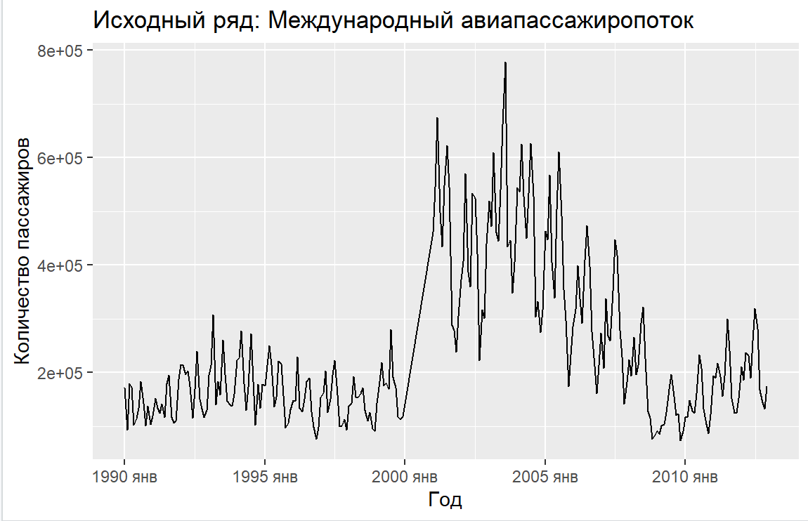
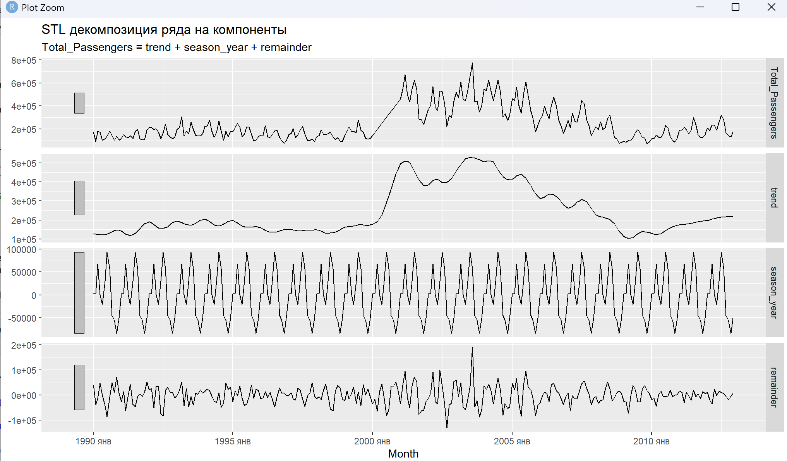
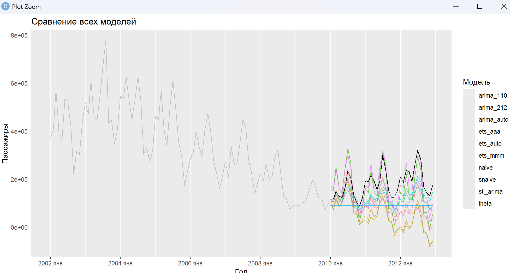
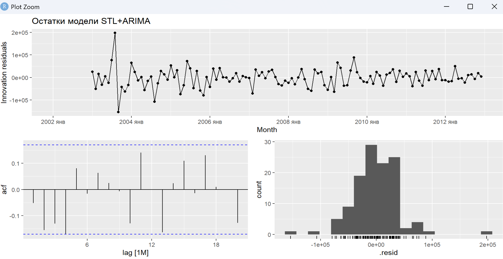

# Анализ и прогнозирование временных рядов (R)

## 1. Постановка задачи
Цель: проанализировать ряд международного авиапассажиропотока (1990–2012 гг.) и построить прогноз. Данные содержат явный тренд, сезонность и структурный сдвиг (около 2000 года).

## 2. Предварительный анализ и декомпозиция
Исходный ряд нестационарен. С помощью STL-декомпозиции были выделены тренд, сезонность и остатки.

Для стабилизации дисперсии применено преобразование Бокса-Кокса (λ = -0.027). Тесты KPSS и Дики-Фуллера подтвердили необходимость дифференцирования.

## 3. Моделирование
Было протестировано 10 моделей (Naive, SNaive, ETS, SARIMA, Theta, STL+ARIMA). 

**Лучший результат** показала гибридная модель **STL+ARIMA**:
*   **RMSE:** 46 529
*   **MAPE:** 24.8%

## 4. Вывод
Модель адекватно уловила структуру данных (остатки похожи на белый шум). Учет структурного сдвига 2000 года критически важен для точности прогноза.

